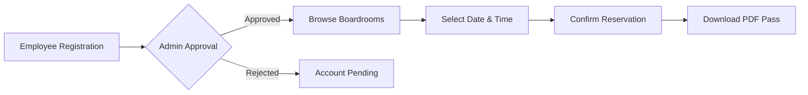
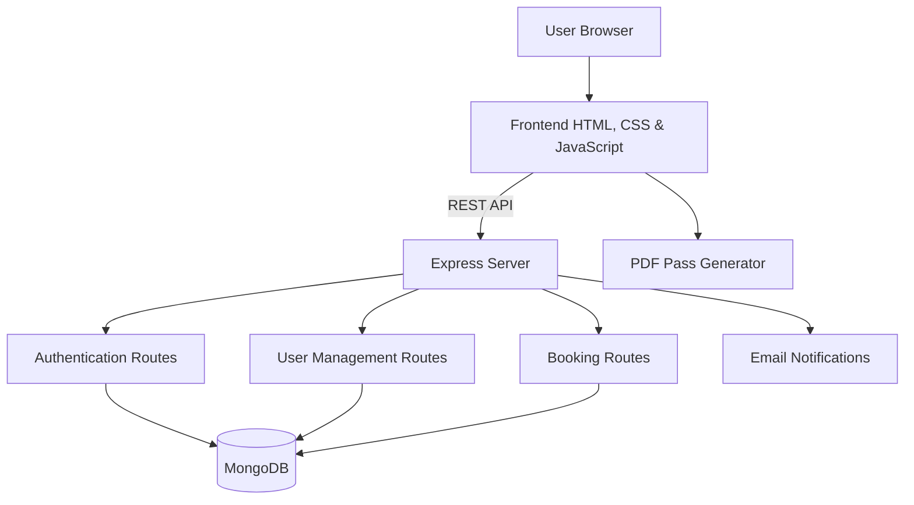
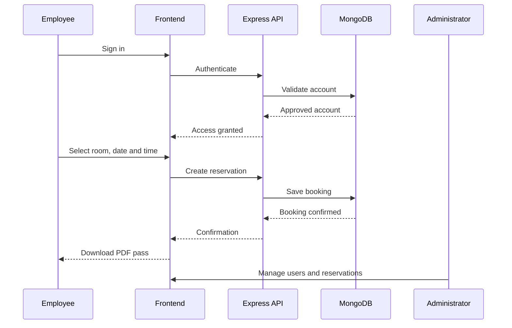

<div align="center">

# 🏢 TASMA Boardroom Booking System

**A modern, responsive reservation platform for managing meetings and boardrooms.**


<br />

[](https://developer.mozilla.org/docs/Web/HTML)
[](https://tailwindcss.com/)
[](https://developer.mozilla.org/docs/Web/JavaScript)
[](https://nodejs.org/)
[](https://expressjs.com/)
[](https://www.mongodb.com/)
[](LICENSE)

<br />

A complete boardroom reservation solution for TASMA Group employees and administrators.

</div>

---

## ✨ Overview

TASMA Boardroom Booking System simplifies meeting-room reservations from discovery to confirmation. Employees can find available rooms, book time slots, and download booking passes, while administrators manage approvals, users, departments, quotas, and reservations.



---

## 🎯 Features

<table>
<tr>
<td width="33%" valign="top">

### 👩‍💼 Employee

- Create and manage an account
- Browse available boardrooms
- Select dates and hourly slots
- Confirm and manage bookings
- Download reservation PDF passes
- Update profile information
- Use department-based features

</td>
<td width="33%" valign="top">

### 🛡️ Administrator

- Approve or reject registrations
- Manage user accounts
- Monitor department quotas
- Oversee registered-user limits
- Review and manage reservations
- Keep booking data organized

</td>
<td width="33%" valign="top">

### 💫 Experience

- Responsive desktop and tablet UI
- Dark and light themes
- Local demo data support
- Toast notifications
- Confirmation dialogs
- QR code support
- Cloud or local MongoDB storage

</td>
</tr>
</table>

---

## 🧰 Technology Stack

| Category | Technologies |
|:---|:---|
| Frontend | HTML5, CSS3, Vanilla JavaScript |
| Styling | Tailwind CSS |
| Icons | Font Awesome |
| Backend | Node.js, Express.js |
| Database | MongoDB, Mongoose |
| PDF | jsPDF |
| QR Codes | QRCode.js |
| Email | Nodemailer |
| Environment | dotenv |

---

## 🗺️ System Architecture



---

## 📁 Project Structure

```text
Tasma_BoardRoom_Booking_System/
├── .env
├── .env.example
├── package.json
├── frontend/
│   ├── index.html
│   ├── assets/
│   │   └── images/
│   ├── css/
│   │   └── styles.css
│   └── js/
│       ├── api.js
│       ├── admin.js
│       ├── app.js
│       ├── auth.js
│       ├── booking.js
│       ├── calendar.js
│       ├── data.js
│       ├── main.js
│       ├── pass.js
│       ├── profile.js
│       ├── tailwind-config.js
│       └── ui.js
├── backend/
│   ├── server.js
│   ├── seed.js
│   ├── create-admin.js
│   ├── config/
│   │   └── db.js
│   ├── models/
│   │   ├── User.js
│   │   └── Booking.js
│   └── routes/
│       ├── authRoutes.js
│       ├── userRoutes.js
│       └── bookingRoutes.js
└── README.md
```

---

## 🚀 Getting Started

### ✅ Prerequisites

- Node.js 18 or newer
- npm
- MongoDB Atlas or a local MongoDB instance
- A Gmail account with an app password for email notifications

### 1️⃣ Install dependencies

```bash
npm install
```

### 2️⃣ Configure the environment

Create or update the `.env` file in the project root:

```env
PORT=5000

MONGODB_URI=mongodb+srv://<username>:<password>@cluster0.example.mongodb.net/boardroom_db

ADMIN_EMAIL=admin@tasmagroup.com

EMAIL_SERVICE=gmail
EMAIL_USER=your_company_email@gmail.com
EMAIL_PASS=your_google_app_password
```

> ⚠️ Never commit real database credentials or email app passwords to GitHub.

### 3️⃣ Start the application

```bash
npm start
```

Open:

```text
http://localhost:5000
```

The server can connect to MongoDB, seed default accounts, expose the API, and serve the frontend.

---

## 🔐 Default Accounts

| Role | Email | Purpose |
|:---|:---|:---|
| Administrator | `admin@tasmagroup.com` | Manage users, registrations, quotas, and reservations |
| Employee | `john@company.com` | Explore the employee booking experience |

> Change default credentials before deploying the application to a public environment.

---

## 🔄 Booking Workflow



---

## 🧪 Development

Run the project in development mode:

```bash
npm run dev
```

For a custom port:

```env
PORT=5000
```

Then open:

```text
http://localhost:5000
```

---

## 🛡️ Security Recommendations

- Add `.env` to `.gitignore`
- Use strong administrator passwords
- Replace seeded credentials in production
- Restrict database network access
- Add server-side validation and rate limiting
- Implement secure session or JWT authentication
- Use HTTPS for public deployments
- Never expose credentials in frontend JavaScript

---

## 🤝 Contributing

1. Fork the repository.
2. Create a feature branch.

```bash
git checkout -b feature/your-feature
```

3. Commit your changes.

```bash
git commit -m "Add your feature"
```

4. Push the branch.

```bash
git push origin feature/your-feature
```

5. Open a pull request.

---

## 📜 License

Distributed for educational and organizational use. Add a `LICENSE` file if you want to publish a specific open-source license.

---

<div align="center">

### Made with 💜 by Suraj Sandeepa & Pathum Liyanage

**TASMA Group — IT Department**

[](https://github.com/Sandeepa02)

</div>
````
